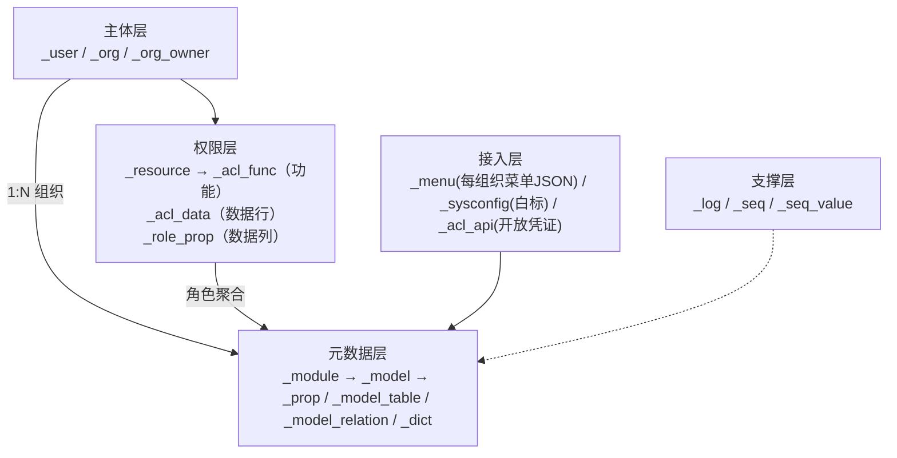

# 总体架构与规模画像

> 数据来自一份 `mysqldump` 全量导出：MySQL 8.0.24、库名 `rbac`、24 张表、约 41 MB，业务数据截止 2021-12。文中所有数字都由 dump 全量解析统计得出，不是抽样估算。

---

## 一、这套 RBAC 是什么

从表结构和数据看，它不是一个纯粹的「用户-角色-权限」小系统，而是一套**多租户物联网业务平台的权限底座 + 低代码后台引擎**，同一套库同时承担四种职责：

| 职责 | 承载表 | 说明 |
|---|---|---|
| 主体与租户 | `_user`、`_org`、`_org_owner` | 账号 + 组织树 + 组织间的「管理归属」关系 |
| 权限模型 | `_resource`、`_acl_func`、`_acl_data`、`_role_prop`、`_role`、`_user_role`、`_role_acl_func`、`_role_acl_data`、`_role_owner` | 功能点 / 数据行 / 字段列 三层权限 |
| 元数据引擎 | `_module`、`_model`、`_model_table`、`_model_relation`、`_prop`、`_dict`、`_menu`、`_sysconfig` | 描述「表怎么变成页面」，5,000 多个业务模型全靠配置 |
| 运行支撑 | `_log`、`_acl_api`、`_seq`、`_seq_value` | 审计、开放 API 凭证、业务流水号 |

业务模块共 16 个（`_module`）：系统、物联卡、物联云设备、短信通道、支付、消息推送、监控预警、共享洗衣、视频、定位、播报音箱、智能电梯、资产管理、消防员安全智能、任务调度、智慧工地。

---

## 二、数据规模（24 张表）

| 表 | 行数 | 角色定位 |
|---|---:|---|
| `_user` | 39,819 | 账号主体 |
| `_org` | 217 | 组织 / 租户 |
| `_org_owner` | 659 | 组织管理归属（谁管谁） |
| `_role` | 58 | 角色 |
| `_user_role` | 483 | 用户↔角色 |
| `_resource` | 1,192 | 权限资源（模型 / 菜单 / 自定义功能） |
| `_acl_func` | 3,704 | 功能点定义（资源上有哪些操作） |
| `_acl_data` | 397 | 数据行权限策略（SQL 片段） |
| `_role_acl_func` | 16,789 | 角色↔功能点授权 |
| `_role_acl_data` | 2,572 | 角色↔行策略授权 |
| `_role_owner` | 1,713 | 角色可见的组织集合 |
| `_role_prop` | 33 | 角色↔字段（列级脱敏） |
| `_module` | 16 | 业务模块 |
| `_model` | 527 | 逻辑模型 |
| `_model_table` | 472 | 模型的多表 JOIN 扩展 |
| `_model_relation` | 113 | 模型间关系（主子表 / 多对多） |
| `_prop` | 6,499 | 字段元数据（含 UI、校验、权限开关） |
| `_dict` | 855 | 值字典（243 个域） |
| `_menu` | 219 | 每个组织一份菜单 JSON |
| `_sysconfig` | 327 | 每个组织一份白标配置 JSON |
| `_log` | 91,097 | 请求审计日志 |
| `_acl_api` | 1 | 开放 API 凭证（apiKey/apiSecret） |
| `_seq` / `_seq_value` | 55 / 60 | 流水号规则 / 按组织计数 |

数据时间跨度：`_user` 2019-05-04 ~ 2021-12-07，`_log` 2020-02-18 ~ 2021-12-09。

几个数字值得注意：

- 5,000+ 字段元数据（6,499 行）描述 527 个模型，平均每模型 12.3 个字段，最重的 `_prop` 自身就有 49 个字段；
- 16,789 条功能授权边 vs 58 个角色 → 平均每角色 289 个功能点，资产类角色达 1,604 个；
- 397 条行权限策略覆盖 **366 个模型** → 权限是「按模型逐张配置」的，不是统一规则；
- `_user` 的 39,819 条里 **36,593 条集中在组织 14（支付音箱）** → 这是 C 端/设备侧账号池，与后台员工账号共用一张表。

---

## 三、分层结构



四层之间的关系是：**元数据层决定「长什么样」**（有哪些模型、字段、关系、菜单），**权限层决定「谁能对什么做什么」**（功能点、行、列），**主体层决定「我是谁、我属于谁」**，接入层负责把前两者按组织拼装成一套可用的后台。

---

## 四、四个核心设计取向

### 4.1 单库多租户，租户 = 组织

没有分库、没有 `tenant_id` 前缀式的表隔离，而是**统一用 `orgId` 作为租户维度的外键**，再通过 `_org_owner` 解决「上级能不能管下级」：

- `_org`（217 条）：组织实体，`parentId` 自引用成树；
- `_org_owner`（659 条）：`(orgId, ownerOrgId)` 的**管理关系闭包**，允许多个上级管同一个组织（132 个组织被多个上级管理），也允许一个上级管一大片（组织 1 管 84 个，组织 524 管 74 个）。这是代理/分销结构的数据化表达。

### 4.2 元数据驱动（低代码后台）

`_model` + `_prop` 就相当于一套「运行期的 DDL + 页面 DSL」：527 个模型里有 8 个用完整 SQL、0 个用存储过程、159 个带默认 `where`、50 个带 `groupBy`、12 个 `distinctEnabled`，其余都是「物理表 + 字段元数据」直接映射。前端后台几乎不写页面，靠元数据渲染。

### 4.3 RBAC + 数据域（事实上的 ABAC）

- 角色只解决「能做什么」（`_role_acl_func`）；
- 「能看到哪些行」交给 `_acl_data` 的 SQL 片段，用 `$user.orgId` / `$user.id` / `$user.username` 做变量注入；
- 「能看到哪些字段」交给 `_role_prop.mask`；
- 「角色在哪些组织内可见」再由 `_role_owner` 收一道口子。

所以它是**三层叠加**：角色 → 功能点；角色 → 行策略；角色 → 可见组织 + 字段掩码。

### 4.4 白标（每个组织一套界面）

`_menu`（219 份菜单 JSON）+ `_sysconfig`（327 份配置 JSON，键为 `logo / desc / copyright / beian / logoChart / shortLogo`）+ `_org.defaultPage`：同一个后台，不同客户登录后是不同的品牌名、不同的一级菜单、不同的默认落地页。

---

## 五、从日志里反推出的 API 形态（推断，源码不在 dump 内）

`_log.url` 显示存在一套**通用 CRUD 引擎**，模型名直接进 URL：

```text
POST /api/generic/info/save
POST /api/generic/update/<model>          # update/_model、update/_prop、update/wl_place_order
POST /api/generic/delete/<model>/<id>/
POST /api/generic/relation_update         # 多对多关系的增量增删（addData / delData）
POST /api/generic/menu                    # 菜单 JSON 读写
POST /api/generic/menu_func_create        # 建菜单时同时建资源+功能点
POST /api/user/login  /  /api/user/login_by_mobile
POST /api/user/create_role  /  /api/user/delete_role/<roleId>
```

日志里同时能看到一次典型的「配角色」操作链：

```text
relation_update  model=_user_role     delData=[{roleId:54,userId:532}]
relation_update  model=_role_acl_func delData=[...]
relation_update  model=_role_acl_data delData=[...]
relation_update  model=_role_acl_func addData=[...]
```

即：**角色配置不调用专用接口，而是「把三类关系表当普通模型做增量更新」**——这是元数据驱动带来的直接收益，也是风险点（关系表的写入口没有业务校验，全靠前端勾选）。

---

## 六、文档地图

| 文件 | 内容 |
|---|---|
| `README.md` | 索引与速览 |
| `01-总体架构与规模.md` | 本文：定位、规模、分层、API 形态 |
| `02-元数据层-低代码模型.md` | `_module/_model/_prop/_model_table/_model_relation/_dict` |
| `03-权限模型总览.md` | 三层权限、双轨角色、权限并集计算 |
| `04-功能权限（菜单与操作）.md` | `_resource/_acl_func/_role_acl_func` |
| `05-数据行权限（_acl_data）.md` | 归属 SQL 片段、`$user` 变量、四种套路、风险 |
| `06-列权限与字段脱敏.md` | `_role_prop`、字段开关与「隐性列权限」 |
| `07-组织与多租户.md` | `_org/_org_owner/_role_owner/_menu/_sysconfig` |
| `08-认证、审计与辅助表.md` | `_user/_acl_api/_log/_seq` |
| `09-设计评价与风险清单.md` | 优点、P0/P1/P2 问题、改造建议、最小可行表集 |
| `附录-表结构速查.md` | 24 张表字段级速查 |
