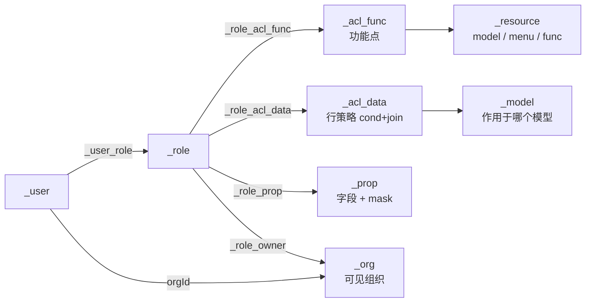

# 权限模型总览：三层权限 + 双轨角色 + 组织域

## 一、一句话结构

```text
用户 ─(N:N)→ 角色 ─(N:N)→ 功能点 ─→ 资源（模型 / 菜单 / 自定义功能）
                 ├─(N:N)→ 行权限策略（一段 WHERE/JOIN）
                 ├─(N:N)→ 字段（列级 mask）
                 └─(N:N)→ 可见组织（数据域）
```

四张关联表把「谁是主体、能做哪些操作、能碰哪些行、能看哪些列、在哪些组织里算数」全部分开表达：

| 关联表 | 行数 | 语义 |
|---|---:|---|
| `_user_role` | 483 | 用户拥有哪些角色 |
| `_role_acl_func` | 16,789 | 角色拥有哪些功能点 |
| `_role_acl_data` | 2,572 | 角色拥有哪些行权限策略 |
| `_role_owner` | 1,713 | 角色在哪些组织内可见/生效 |
| `_role_prop` | 33 | 角色对哪些字段做屏蔽 |

---

## 二、三层权限分别解决什么

| 层 | 载体 | 表达粒度 | 规模 | 回答的问题 |
|---|---|---|---|---|
| 功能权限 | `_resource` + `_acl_func` + `_role_acl_func` | 「某个资源上的某个操作」 | 1,192 资源 / 3,704 功能点 / 16,789 授权边 | 能不能进这个菜单、能不能点「新增/删除/导入」、能不能调「开卡/续费/审批」 |
| 数据行权限 | `_acl_data` + `_role_acl_data` | 「某模型的结果集过滤条件」 | 397 策略 / 366 模型 / 2,572 授权边 | 列表里能出现哪些行 |
| 数据列权限 | `_role_prop` + `_prop` | 「某角色看不到某个字段」 | 33 条 | 这些行的哪些字段要遮住 |
| 数据域 | `_role_owner` + `_org_owner` | 「角色在哪些组织内生效」 | 1,713 条 | 这个角色的权限在谁的租户里算数 |



---

## 三、关键设计：拆成「双轨角色」

这是整套权限里最值得注意、也最容易被忽略的一点。

**现象**：58 个角色里，有一批角色**只授功能、不授数据**，另一批角色**只授数据、不授功能**：

| 角色 | 功能点 | 其中菜单 | 其中模型 | 数据策略 | 可见组织 |
|---|---:|---:|---:|---:|---:|
| 超级管理员 | 874 | 155 | 718 | 0 | 65 |
| 账户管理员 | 48 | 5 | 43 | 5 | 0 |
| 物联卡管理员 | 230 | 39 | 191 | 2 | 85 |
| **数据过滤（全部）** | **3** | 0 | 3 | **54** | 0 |
| **物联卡数据过滤** | **12** | 0 | 12 | **25** | 0 |
| **设备数据过滤** | **3** | 0 | 3 | **11** | 0 |
| **账户数据过滤** | **3** | 0 | 3 | **17** | 0 |
| **支付数据过滤** | **314** | 52 | 262 | **5** | 0 |
| 资产管理员 | 1,562 | 145 | 1,417 | 165 | 7 |
| 资产作业员 | 1,289 | 77 | 1,212 | 125 | 6 |

**用数据验证的组合行为**：

- 483 条 `_user_role` 分布在 170 个多角色用户上（最多 8 个角色）；
- 其中 **162 个用户同时持有「数据过滤类角色」和「业务角色」**。

例如用户 2：

```text
账户管理员 + 物联卡管理员 + 设备管理员 + 支付管理员 + 短信管理员
+ 物联卡数据过滤 + 设备数据过滤 + 账户数据过滤
```

**设计意图（推断，与数据高度一致）**：

- 「业务角色」回答**能不能做**（功能点、菜单）；
- 「数据过滤角色」回答**能看到谁的数据**（`_acl_data` 策略）；
- 一个用户在功能上「能管物联卡」，但只应看到「分管的那批组织」的卡 —— 于是叠加一个 `物联卡数据过滤` 角色，由它承载那一套 `JOIN _org_owner ... ownerOrgId = $user.orgId` 的行策略。

这样做的两个好处：

1. **功能与数据解耦**，同一个人可以「权限大、视野小」（例如总部管理员功能全开，但只看自己那片），反之亦然；
2. **策略复用**：`物联卡数据过滤` 的 25 条策略可以被任意业务角色叠加，不用为每个业务角色重配一遍行过滤。

代价是：**多角色权限取并集，而数据行策略一旦并集就「越叠越宽」**。如果两个过滤角色的策略互斥（A 只看组织 1、B 只看组织 2），并集结果是「看 1 和 2」 —— 没有「交集」或「优先级覆盖」的表达能力。这正是 `_acl_data.order` 字段可能存在的原因（见 05）。

---

## 四、一次请求的鉴权链路（按表结构还原，推断）

```text
1. 认证   : _user.username/password  → 得到 user（含 orgId）
           或 _acl_api.apiKey/apiSecret → 得到机器身份（userId + orgId）
2. 定位资源: URL 的 model 名 → _resource(resource=model, type='model')
3. 功能鉴权: role_acl_func.aclFuncId → acl_func.funcKey
           （_acl_func 上有 query/view/create/update/delete/import/export/...）
4. 域收敛  : 角色必须落在 _role_owner(roleId, orgId) 里，否则该角色在当前组织不生效
5. 行收敛  : 取该角色已授权的 _acl_data（按 model 匹配），
           把 cond 追加进 WHERE、join 追加进 FROM，
           并把 $user.id / $user.orgId / $user.username 替换成真实值
6. 列收敛  : 取 _role_prop(roleId, propId, mask)，把对应字段屏蔽/脱敏
7. 审计    : 写 _log（method/url/data/opUser/ip/timeCost/orgId）
```

`_acl_data` 的 `model` 字段能直接对上 `_model.model`，`_acl_func.resourceId` 能直接对上 `_resource.id` —— 整个链路没有一层「权限码字符串」映射，全是主键 JOIN，这是它的优点（不用维护权限码字典）。

---

## 五、为什么这套权限「看起来能用」

1. **资源即模型名**：`_resource.resource` 直接存 `iot_device`、`_user`、`/auth/role` 这样的名字，URL、模型、权限资源三者同名，前端不需要额外映射表；
2. **功能点是数据行**：`_acl_func` 3,704 行，每行一个「资源 + funcKey」组合，`UNIQUE(resourceId, funcKey)` 保证不重复 —— 想给某个模型加「批量同步」权限，插一行即可，不用改代码；
3. **新增模型 = 自动获得一套权限点**：`/api/generic/menu_func_create` 在日志里出现 148 次，说明**建菜单时会同时建 `_resource` + `_acl_func`**，权限点跟着菜单自动生成；这解释了 `_acl_func` 为什么有 1,169 个 `viewEnabled`（649 个菜单资源几乎每个都有）+ 大量 `query/create/update/delete`（541 个模型资源）。

---

## 六、三处结构性短板

| 短板 | 证据 | 影响 |
|---|---|---|
| **无角色继承** | `_role` 只有 `name/code`，没有 `parentId` 或 `role_set`；但日志里出现过 `create_role` 带 `parentId: '67'` 的请求，`_log.data` 却无写入痕迹 → 继承关系未落到表里 | 大角色（1,604 个功能点）× 58 个角色意味着大量重复配置，改一次口径要改几十个角色 |
| **权限无冲突检测** | 多角色并集，`_role_acl_func` 只有 `(roleId, aclFuncId)`，语义是「有=允许」，**没有任何 deny 位** | 只能「加法授权」，做不了「某组织禁止导出」这类精细化收回 |
| **数据域的双保险没有优先级** | `_role_owner` 限定角色生效组织，`_acl_data` 内部又用 `$user.orgId` 过滤 | 两层都在做组织收敛，口径不一致时结果取决于 SQL 拼出来的形状，而不是显式规则 |

> 第 3 点值得展开：`_role_owner` 是「角色级的组织白名单」，`_acl_data` 的 `cond/join` 里又硬编码了 `_org_owner.ownerOrgId = $user.orgId`（**用户级的组织关系**）。前者按角色、后者按当前用户，两者不是一个维度 —— 一个用户如果持有「在组织 A 生效」的角色、但自己属于组织 B，这套组合下的可见范围要看具体 SQL 拼接结果，缺乏可预期的定义。

---

## 七、小结

- 权限模型的正统部分（资源 → 功能点 → 角色 → 用户）做得干净、可扩展，且与前端 UI 共用词表；
- 真正的「业务味道」来自**把数据范围表达为 SQL 片段 + 模板变量**，这一招让 397 条策略覆盖了 366 个模型，省掉了逐表写 scope 的工程量，但也把安全边界放在了字符串拼接上；
- 架构上最聪明的一步是**拆出独立的「数据过滤角色」**，让功能权限和数据视野解耦、可叠加 —— 这是多租户 SaaS 里非常实用的取舍（详见 5、7 两处配套说明）。
